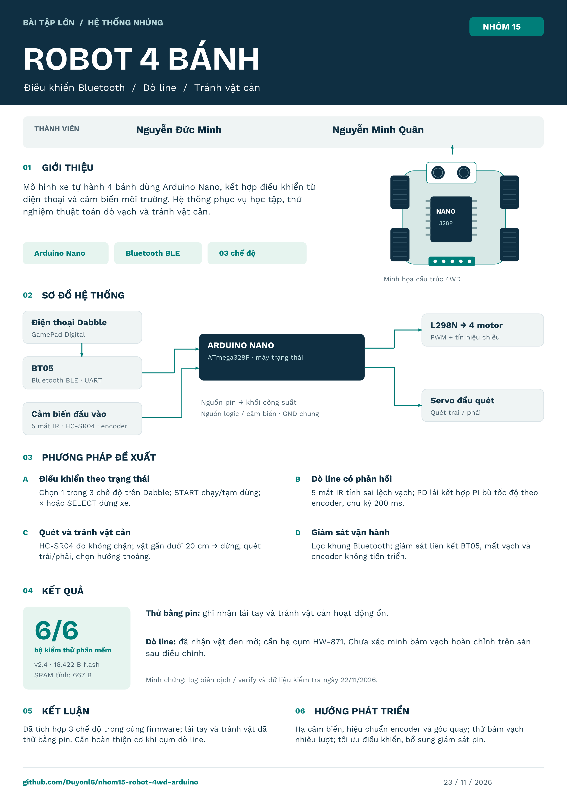
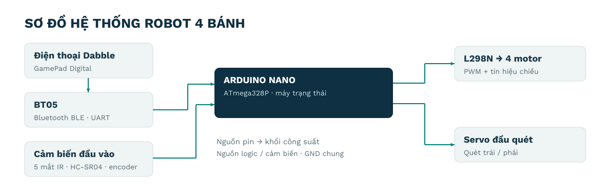
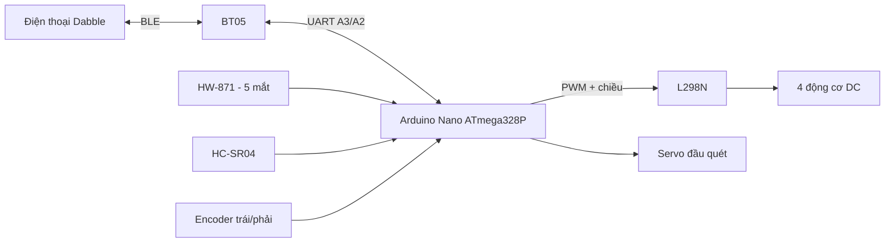

# Robot 4 bánh Arduino Nano - Nhóm 15

**Điều khiển Bluetooth · Dò line · Tránh vật cản**

| Nhóm | Thành viên |
|---|---|
| Nhóm 15 | Nguyễn Đức Minh |
| | Nguyễn Minh Quân |

Bài tập lớn Hệ thống nhúng, nộp ngày **23/11/2026**. Robot dùng Arduino Nano ATmega328P, L298N, BT05, encoder, cảm biến 5 mắt và HC-SR04 gắn servo. Xe là mô hình học tập tích hợp cảm nhận môi trường, điều khiển động cơ và giao tiếp điện thoại. Kết nối hiện tại là **Bluetooth BLE qua Dabble**; không dùng Wi-Fi.

## Poster A4

[**Tải poster PDF để in**](Poster_A4.pdf) · [Ảnh 300 dpi](Poster_A4.png)



## Tải trọn dự án

[**Project_Full.zip - tải và giải nén toàn bộ dự án**](Project_Full.zip)

Kho nộp lưu đủ mã nguồn, thư viện và dữ liệu trong các gói ZIP, giữ đúng cấu trúc thư mục. Các tệp nguồn chính cũng được đặt trực tiếp ở trang này để xem nhanh. Chạy lệnh biên dịch và kiểm thử sau khi giải nén **Project_Full.zip**; không chạy lệnh ở thư mục chỉ chứa ZIP.

## Thành phần bài nộp

| Yêu cầu | Tệp nộp |
|---|---|
| Poster A4 | [PDF để in](Poster_A4.pdf), [PNG 300 dpi](Poster_A4.png) |
| Code | [Code.zip](Code.zip); xem trực tiếp [sketch](robot_4wd_3in1.ino), [BtLinkMonitor.h](BtLinkMonitor.h), [SonarCapture.h](SonarCapture.h) |
| Thư viện | [Libraries.zip](Libraries.zip): DabbleRobot 1.5.2, NeoSWSerial 3.0.5, Servo 1.3.0; có mã nguồn và giấy phép |
| Dữ liệu | [Data.zip](Data.zip), [bảng kết quả CSV](Results.csv): log biên dịch, xác minh và 6 bộ test |
| Hướng dẫn, sơ đồ | [Documents.zip](Documents.zip): cách chạy, bảng chân, kết quả, sơ đồ và nguồn poster |
| Trọn dự án, đúng cấu trúc | [Project_Full.zip](Project_Full.zip): giải nén để biên dịch và thử |

## Cách dùng nhanh

1. Bật pin, Dabble → GamePad → Digital → kết nối BT05.
2. Bấm-thả **×**; chọn **△** (tay), **□** (dò line), **○** (tránh vật) rồi bấm **START**.
3. Lái tay: giữ mũi tên để chạy, thả để dừng. **×/SELECT** dừng ở mọi chế độ.
4. Dò line: dùng vạch đen mờ trên nền sáng và chỉnh độ cao cảm biến để nhận vạch ngay khi xe đứng tự nhiên.

**Trước khi cắm USB/nạp: tắt pin động cơ.** D0/D1 dùng chung UART USB và cầu H. Chi tiết: hướng dẫn `docs/how-to-run.md` trong [gói tài liệu](Documents.zip).

## Sơ đồ hệ thống





## Phương pháp đề xuất

- **Máy trạng thái:** chọn một trong ba chế độ; khởi động ở trạng thái dừng; đổi chế độ cần START.
- **Dò line:** tính sai lệch trọng số từ 5 mắt; PD lái kết hợp PI bù tốc độ theo encoder (cửa sổ 200 ms).
- **Tránh vật:** HC-SR04 đo không chặn bằng ngắt; dưới 20 cm thì dừng, servo quét và quay về phía thoáng.
- **Giám sát:** lọc khung Bluetooth, kiểm phản hồi BT05; xử lý lỗi UART, mất vạch và encoder không tiến triển.

## Kết quả

- Firmware **v2.4**, log 22/11: nạp và đối chiếu 16.422 byte; SRAM tĩnh 667 byte.
- Sáu bộ kiểm thử host đạt; kết quả chạy lại lúc đóng gói nằm trong `data/submission-host-tests.json`.
- Người dùng báo thử pin: **lái tay và tránh vật cản ổn**.
- Dò line nhận vật đen mờ nhưng cần **hạ cảm biến**; chưa xác minh bám vạch hoàn chỉnh trên sàn sau điều chỉnh.

Không có tập dữ liệu AI; dữ liệu nộp là dữ liệu kiểm chứng. Không công bố vận tốc thực, tỉ lệ thành công hoặc sai số khi chưa đo. Phạm vi minh chứng: `docs/verification.md` trong [gói tài liệu](Documents.zip).

## Biên dịch

```sh
arduino-cli core install arduino:avr@1.8.8
arduino-cli compile --fqbn arduino:avr:nano:cpu=atmega328 --library libraries/DabbleRobot --library libraries/NeoSWSerial --library libraries/Servo robot_4wd_3in1
```

## Kết luận và hướng phát triển

Đã xây dựng nền tảng robot 4 bánh với ba chế độ điều khiển trong cùng firmware; lái tay và tránh vật đã có phản hồi thử pin. Tiếp tục chỉnh cơ khí cảm biến, đo bám vạch nhiều lượt, hiệu chuẩn encoder/đường kính bánh/góc quay và tối ưu tham số điều khiển. Có thể bổ sung giám sát pin, ứng dụng điều khiển riêng và kết nối Wi-Fi ở phiên bản sau.

## Nguồn và giấy phép

Mã robot đóng gói từ firmware v2.4 ngày 22/11/2026; không thay firmware trên xe trong tác vụ nộp bài. Thư viện có giấy phép riêng, xem `libraries/README.md` và LICENSE trong từng thư mục. Phông chữ poster theo SIL OFL trong `assets/fonts/`.

Bố cục thông tin tham khảo repo thuyền IoT do giảng viên cung cấp: https://github.com/tutran56/IoT-trash-collector-boat. Không dùng code hoặc dữ liệu của dự án thuyền làm mã robot.
